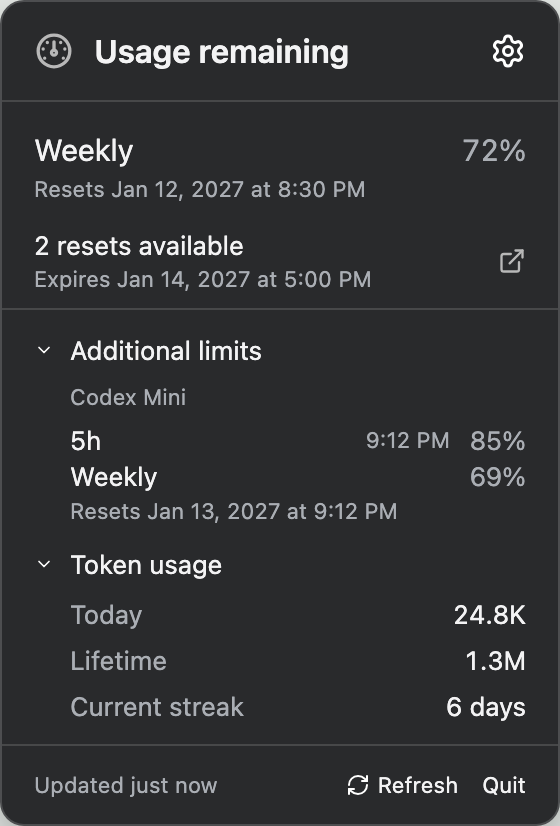
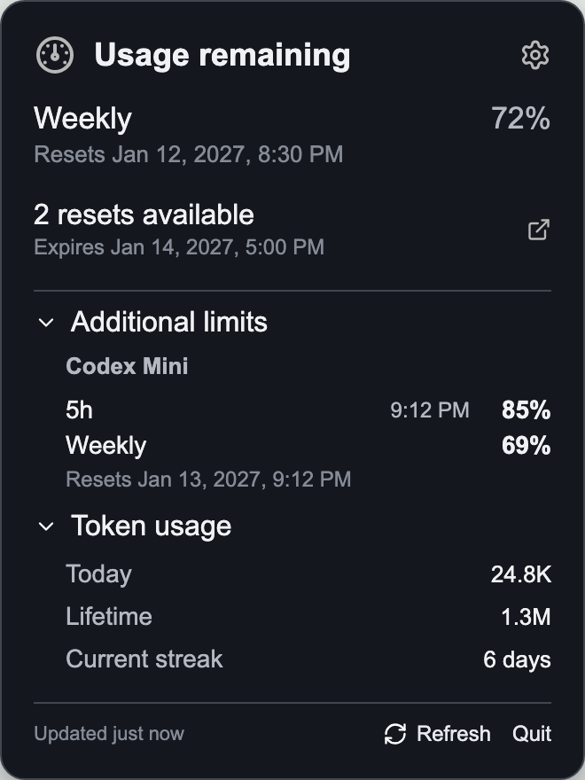

# ChatGPT Usage

> **Installation security:** Windows downloads are not publisher-signed. Mac releases may be Developer ID signed and notarized; check the release notes for the package you download. Unsigned packages may trigger operating-system warnings. Only proceed if you trust the source and have verified the file. Read [Unsigned installation and security warnings](UNSIGNED-INSTALL.txt) for the app-specific **Open Anyway** (Mac) and **More info → Run anyway** (Windows) steps. Do not disable system-wide security protections.

A lightweight macOS menu-bar and Windows tray companion for viewing Codex usage. Both apps show the remaining weekly percentage and reset date, available reset credits and their expiration, extra model limits, token totals, refresh controls, and a direct link to the ChatGPT usage dashboard.

On macOS, click the menu-bar item to open the usage menu or double-click it to open the ChatGPT desktop app. On Windows, the percentage stays visible in a floating widget near the clock; click the widget or tray icon to open the full usage popup, or drag the widget wherever you prefer. Its position is remembered, and **Reset widget position** in the tray menu returns it to the bottom-right corner.

This is an unofficial local companion and is not distributed by OpenAI.

The apps launch a local `codex app-server` process and reuse Codex's existing ChatGPT sign-in. They do not read, copy, or store authentication tokens.

## Screenshots

<table align="center">
  <tr>
    <th>macOS menu</th>
    <th>Windows popup</th>
  </tr>
  <tr>
    <td align="center" valign="top"></td>
    <td align="center" valign="top"></td>
  </tr>
  <tr>
    <th>macOS menu bar</th>
    <th>Windows widget</th>
  </tr>
  <tr>
    <td align="center" valign="top"></td>
    <td align="center" valign="top"></td>
  </tr>
</table>

## Download and install

[Download the latest release](https://github.com/asetho/ChatGPT-Usage/releases/latest), including the matching `.sha256` file for your package.

| Platform | Package | Requirements |
| --- | --- | --- |
| macOS | `ChatGPTUsage-<version>.dmg` | macOS 13 or later; Apple silicon or Intel |
| Windows | `ChatGPTUsage-Setup-<version>.exe` | Windows 11, x64 |

Both platforms require a working Codex CLI signed in to ChatGPT under the same user account. The macOS app can also use the CLI bundled with the ChatGPT desktop app.

On macOS, **Settings** in the usage menu includes **Launch at login** and a **Choose…** option for selecting a Codex executable or the ChatGPT/Codex app. **Use Automatic** returns to automatic detection. If macOS requests approval for launch at login, select **Open Login Items** to finish enabling it.

After a failed refresh, the apps retain the last successful percentage and mark it with `!`; the popup shows that the data is stale and when it was last updated. Optional token statistics do not prevent available quota data from appearing.

**Plan compatibility:** the app does not restrict ChatGPT plan types; it displays the limits returned by the signed-in Codex CLI. Business, Enterprise, and Edu workspaces may use different seat allowances, workspace credits, spend controls, or reset windows, so their popup details can differ from Plus and Pro. This companion does not replace workspace billing or administration views.

### macOS

1. Download the DMG and its matching `.dmg.sha256` file.
2. Verify the download from the directory containing both files:

   ```sh
   shasum -a 256 -c ChatGPTUsage-<version>.dmg.sha256
   ```

3. Open the DMG and copy **ChatGPT Usage** to Applications.
4. Open the app. For an unsigned release, if macOS blocks it, follow the app-specific **Open Anyway** steps in [UNSIGNED-INSTALL.txt](UNSIGNED-INSTALL.txt). Do not disable Gatekeeper.

### Windows

1. Download the setup executable and its matching `.exe.sha256` file.
2. Verify the download in PowerShell and compare the complete result with the checksum file:

   ```powershell
   Get-FileHash .\ChatGPTUsage-Setup-<version>.exe -Algorithm SHA256
   ```

3. Run the installer. If Codex CLI is missing, setup explains the requirement and offers to run OpenAI's current official installer. You can decline and install Codex yourself.
4. Sign in to Codex separately if needed. The companion launches after setup and starts automatically when you sign in to Windows.

For unsigned-app warnings and checksum guidance, read [UNSIGNED-INSTALL.txt](UNSIGNED-INSTALL.txt). A matching checksum detects a mismatched download; it is not a publisher signature or malware scan.

## Privacy and limitations

The optional Windows Codex installation downloads and runs OpenAI's current installer over HTTPS, so its contents can change independently of this app. Only set `CODEX_EXECUTABLE` to a binary you trust.

Both apps check this repository's latest published GitHub release at launch and every 12 hours while running. When a newer version has matching packages and checksums, choose **Update now** to download, verify, install, and reopen the app. The Mac app must be in a writable Applications folder; Windows must have been installed with this project's installer. Updates preserve app settings and sign-in state. **View release** is available for manual installation; failed update checks are silent.

Installation starts only when you choose **Update now**. Packages are checked against GitHub's SHA256 asset digests and the accompanying checksum file. These checks detect mismatched downloads; they do not verify a publisher signature. Developer ID signing and notarization provide separate macOS publisher and Gatekeeper checks when a release uses them. Normal macOS and Windows security approval may still be required. If a Mac update cannot launch, the helper restores the previous app. Existing versions without **Update now** need one manual installation of a build containing this feature.

See [Privacy](PRIVACY.md) for local data and subprocess behavior, and [Security](SECURITY.md) for reporting concerns. The app uses experimental Codex API capabilities; compatibility can change when Codex updates. Usage figures may be unavailable or stale and should be confirmed in the official dashboard.

## Build from source

### macOS

```sh
scripts/build-macos-dmg.sh
```

Requires Xcode and [XcodeGen](https://github.com/yonaskolb/XcodeGen). The script uses [dmgbuild](https://github.com/dmgbuild/dmgbuild) for a branded Finder install window, installing the build-only tool into ignored `build/dmgbuild-venv` on first use if needed. It creates `dist/ChatGPTUsage-<version>.dmg` and its checksum.

For a Developer ID signed and notarized DMG, install a **Developer ID Application** certificate in your keychain and store notarization credentials with `xcrun notarytool store-credentials <profile>`. Then build with both settings:

```sh
DEVELOPER_ID_APPLICATION='Developer ID Application: Name (TEAMID)' \
NOTARYTOOL_KEYCHAIN_PROFILE='<profile>' \
scripts/build-macos-dmg.sh
```

The script signs the app with hardened runtime and a secure timestamp, submits the DMG to Apple, staples and validates the ticket, then writes the package and checksum. The notarized DMG shows only the app and Applications shortcut; its signed app bundle includes `LICENSE`. If Apple is still processing after 30 minutes, the signed DMG and submission ID remain in `OUTPUT_DIR/.notarization-<version>`; rerun the same command to resume that submission without uploading another copy. The output package is written only after notarization succeeds. Without both settings, the script creates the existing ad hoc signed, unnotarized build with visible installation notes. Set `OUTPUT_DIR` to build into an isolated folder; the script will not overwrite an existing package of the same version.

### Windows

Run from PowerShell:

```powershell
scripts\build-windows-installer.ps1
```

Requires the .NET SDK 10.0.401 (or a newer 10.0.4xx patch) and Inno Setup 6. The script creates `Windows/dist/ChatGPTUsage-Setup-<version>.exe` and its checksum.

### Versioning and packages

`VERSION` is the release version for both platforms. The Windows build generates the executable and Start-menu icon from the same ChatGPT tray mark. Windows packages remain unsigned. Mac packages are notarized only when built with the Developer ID and notary profile settings above; otherwise the Mac bundle uses a local ad hoc signature for Login Items, which does not verify the publisher.

The unsigned installation warning is included only in unsigned Mac DMGs and is displayed before Windows setup installs the app. Build scripts normally retain the three newest packages and their checksums. To preserve existing packages during local verification, use `KEEP_OLD_PACKAGES=1 scripts/build-macos-dmg.sh` or `scripts\build-windows-installer.ps1 -KeepOldPackages`.

Before publishing, follow the [release checklist](RELEASE-CHECKLIST.md). Building locally does not publish a release.

## License

The project source is available under the [MIT License](LICENSE), copyright 2026 `asetho™`. See the [trademark notice](TRADEMARKS.md) for `asetho` branding, third-party marks, and legal information. The license covers only material the copyright holder has authority to license; third-party names, trademarks, and artwork remain subject to their respective owners' rights.
